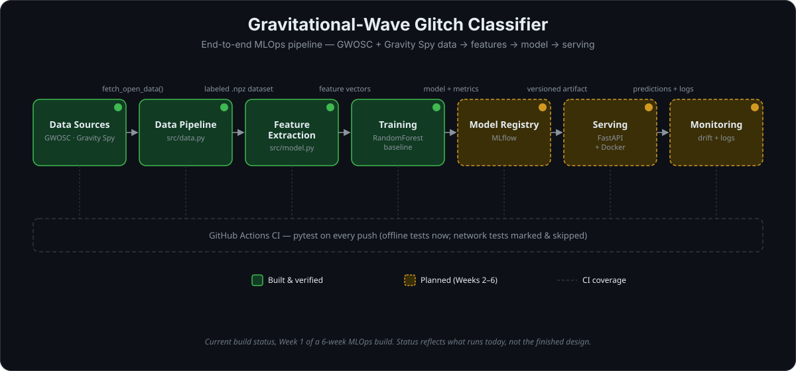

# Gravitational Wave Glitch Classifier — MLOps Case Study

**Status:** 🚧 In progress (Week 1 of 6)



## Overview

A binary classifier that distinguishes gravitational-wave-like signal segments
from detector glitches in LIGO strain data, wrapped in a full MLOps pipeline:
reproducible data pipeline, unit tests, experiment tracking, containerization,
CI/CD, model registry, deployment, and monitoring.

This project exists to demonstrate production ML engineering practice applied
to a real scientific problem — glitch classification is an actual open
challenge for the LIGO/Virgo collaboration, not a toy dataset.

## Problem

LIGO strain data is contaminated by instrumental and environmental noise
transients ("glitches") that can resemble or mask real astrophysical signals.
Distinguishing signal from glitch is a real classification problem the
collaboration works on at scale (see the Gravity Spy citizen-science project).

**Task:** Given a 4-second strain segment, classify it as `signal` or `glitch`.

**Data sources:**
- [GWOSC](https://gwosc.org) — public LIGO/Virgo strain data, accessed via `gwpy`
- [Gravity Spy](https://www.zooniverse.org/projects/zooniverse/gravity-spy) — labeled glitch classes (public metadata release)

**Known Week-1 simplification:** confirmed signal-bearing segments are rare, so
the `signal` class is currently built from short windows around confirmed
GWTC event GPS times, while `glitch` examples come directly from Gravity Spy
labels. This is a reasonable first baseline but is called out here
deliberately — a real class-balance and labeling strategy is a Week 2+ item.

**Known Week-1 simplification (Gravity Spy coverage):** the Gravity Spy
Zenodo record splits metadata into one CSV per detector per observing run
(e.g. `H1_O1.csv`, `L1_O3b.csv`) rather than one combined file. For Week 1,
`load_glitch_labels()` pulls from a single run per detector (the smallest
available, O1) rather than pooling across all runs — pooling is a
reasonable Week 2+ extension once the pipeline is proven end-to-end.

## Architecture

See the diagram at the top of this README. Green stages are built and
verified (at least against synthetic data — see the Build log below for
what "verified" means at each stage); amber stages are planned for
Weeks 2–6.

## Repo structure

```
gw-glitch-mlops/
├── src/
│   ├── data.py      # GWOSC + Gravity Spy data loading, dataset assembly
│   ├── model.py      # Feature extraction + baseline model definition
│   └── train.py      # Training entrypoint (build data -> featurize -> train -> save)
├── tests/            # pytest unit tests (network-dependent tests marked `network`)
├── data/
│   ├── raw/           # Cached raw downloads (gitignored)
│   └── processed/      # Assembled dataset .npz (gitignored)
├── models/            # Serialized model artifacts (gitignored; tracked via MLflow later)
├── configs/            # YAML config files for training runs
├── notebooks/         # Exploratory notebooks (not production code)
├── docs/              # Design notes, write-ups
├── .github/workflows/ # CI pipeline
├── Dockerfile
├── requirements.txt
├── pytest.ini
└── README.md
```

## Setup

```bash
git clone <repo-url>
cd gw-glitch-mlops
python -m venv venv
source venv/bin/activate
pip install -r requirements.txt
```

## Usage

```bash
# Train the baseline (downloads real GWOSC + Gravity Spy data on first run)
python -m src.train --config configs/baseline.yaml

# Force a fresh data pull even if a cached dataset exists
python -m src.train --config configs/baseline.yaml --rebuild-data

# Run the offline unit test suite (no network required)
pytest tests/

# Run network-dependent tests explicitly
pytest tests/ -m network

# Sanity-check the training pipeline with synthetic data (no network needed) —
# useful for verifying src/train.py and src/model.py in an offline/sandboxed
# environment where GWOSC/PyPI access is restricted
python scripts/sanity_check_training.py

# Build and run the training container
docker build -t gw-glitch-api .
docker run gw-glitch-api
```

## Build log / design decisions

This section doubles as a running case study of engineering tradeoffs made
along the way.

- **Week 1:** Dataset assembly (GWOSC + Gravity Spy), hand-engineered time/
  frequency-domain features, RandomForest baseline, offline unit tests for
  the feature pipeline, CI skeleton. Signal-class labeling simplification
  noted above as a known limitation to revisit. Training pipeline
  (`src/train.py`) sanity-checked end-to-end against synthetic data via
  `scripts/sanity_check_training.py`, since the dev sandbox used to build
  this couldn't reach PyPI/GWOSC — **real GWOSC download has not yet been
  run** and is the first thing to verify in your own environment.
- **Week 2:** Package hardening, more test coverage (data pipeline edge
  cases), proper train/val/test split by event rather than random shuffle.
- **Week 3:** MLflow experiment tracking, Dockerized training.
- **Week 4:** CI/CD via GitHub Actions (already scaffolded), model registry.
- **Week 5:** FastAPI serving layer, deployment.
- **Week 6:** Monitoring, final write-up.

## Author

David Leon, Ph.D. (Physics) — applied ML/data analysis, with a background in
CMB polarization analysis and precision measurement. This project was built
to demonstrate MLOps engineering practice grounded in real scientific data.

davidleon137@gmail.com
